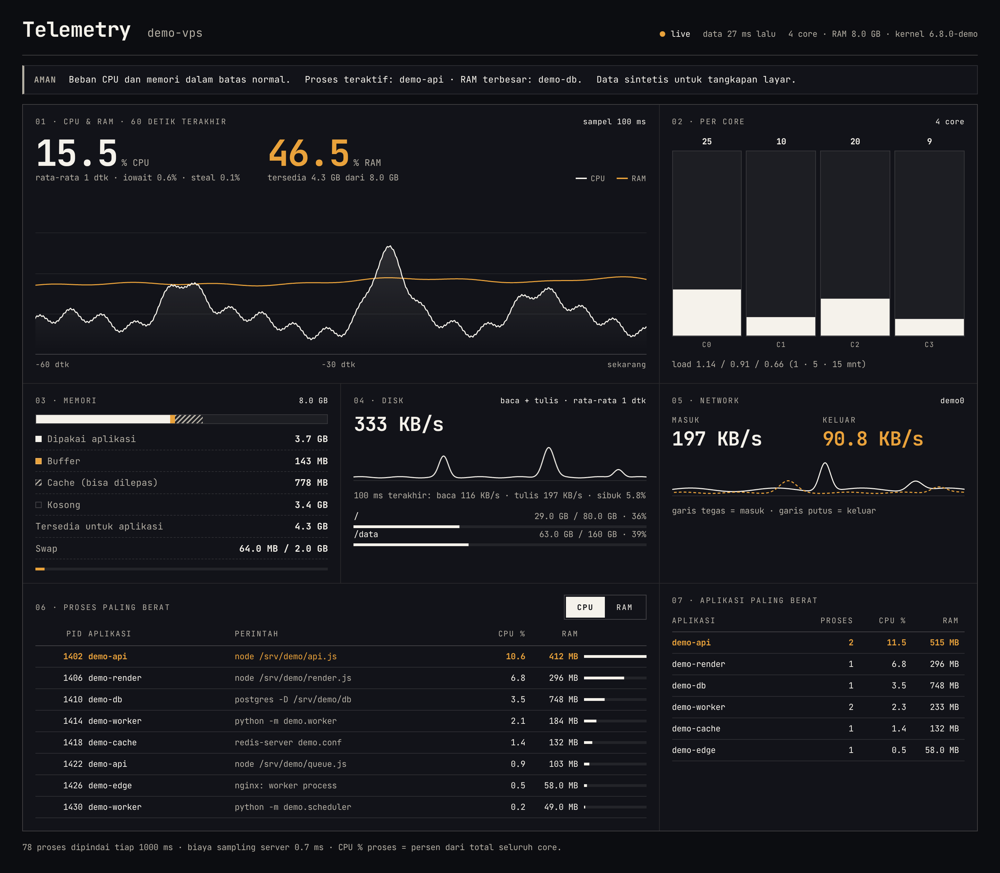

# VPS Monitor

Dashboard ringan untuk memantau CPU per core, RAM dan swap, aktivitas disk, trafik jaringan, serta proses dan aplikasi yang paling banyak memakai sumber daya. Grafik menampilkan 60 detik terakhir.



*Tangkapan layar memakai UI asli dengan data SSE sintetis; bukan data dari VPS nyata.*

## Menjalankan di Linux

- Gunakan Linux dengan `/proc` yang dapat dibaca dan Node.js 18.15.0 atau lebih baru pada seri LTS (minimum ini diperlukan oleh `fs.statfsSync`; pilih versi LTS yang masih didukung).
- Server memakai modul bawaan Node.js. Tidak perlu `npm install` untuk menjalankan perintah berikut.

```sh
node server.js
```

Buka <http://127.0.0.1:3091/monitor/>. Port dapat diganti, misalnya `PORT=3092 node server.js`; alamat tetap `127.0.0.1`. Jalankan `npm test` untuk memeriksa sintaks JavaScript tanpa menyalakan server.

## Aliran data

UI membuka **Server-Sent Events (SSE)** di `/monitor/stream`. Event `hello` membawa metadata host dan riwayat awal. Setelah itu server mengirim sampel sekitar setiap 100 ms; daftar proses dan diagnosis diperbarui sekitar setiap satu detik. Riwayat disimpan di memori, bukan di disk. `/monitor/healthz` menyediakan pemeriksaan kesehatan lokal.

## Keamanan

Aplikasi **tidak menyediakan autentikasi**. Jangan mengeksposnya langsung ke internet. Stream memuat metadata host dan rincian proses, termasuk pengguna, argumen perintah, dan nama layanan. Penyaringan argumen berbasis pola tidak menjamin semua rahasia terhapus.

Untuk akses jarak jauh, gunakan SSH port forwarding atau reverse proxy privat dengan autentikasi yang melindungi seluruh rute monitor. Jangan menerbitkan alias tanpa prefix seperti `/stream`; nonaktifkan buffering respons SSE pada proxy. Docker tidak wajib: jika `docker ps` tersedia, monitor dapat menampilkan nama kontainer. Jangan berikan akses socket Docker hanya demi label tersebut.

Lisensi font JetBrains Mono disertakan di [public/fonts/OFL-jetbrains-mono.txt](public/fonts/OFL-jetbrains-mono.txt).
